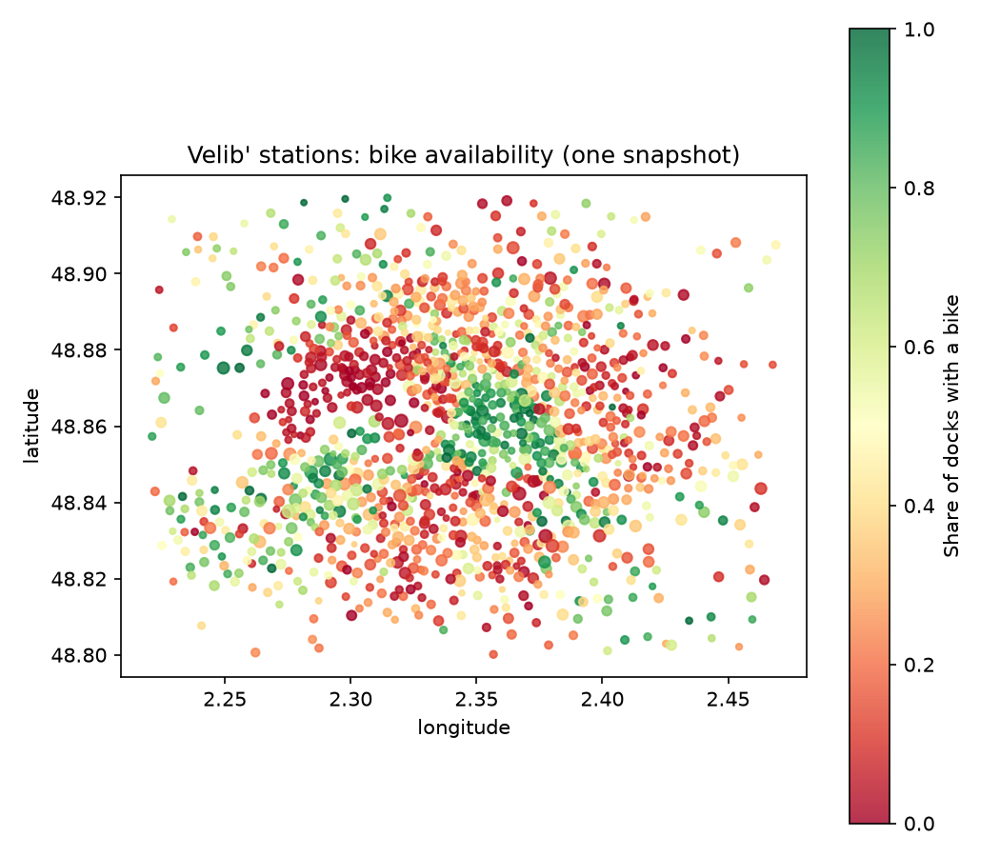

# Velib' Data Pipeline (collect, check, transform, dashboard)

[](https://github.com/BilalBess/velib-data-pipeline/actions/workflows/ci.yml)
[](https://github.com/BilalBess/velib-data-pipeline/actions/workflows/collect.yml)

A small but complete **data engineering project** on Paris open data: every hour, a GitHub Actions job downloads the state of all Velib' stations, checks the data quality, and stores it. SQL models then turn the raw snapshots into analytical tables, shown in a Streamlit dashboard.
Open data APIs only give the *current* state, so the history does not exist unless someone collects it. This project builds that history.

## Architecture
```text
 Paris open data API        GitHub Actions (cron, every hour)                 your machine / dashboard
 (1,500 stations, ~1 min)   ┌───────────────────────────────┐                 ┌──────────────────────────────┐
         │                  │ collect.py                    │   `data` branch │ transform.py (DuckDB SQL)    │
         └─────────────────>│  1. download + normalise      │────────────────>│  01 staging (clean, local    │
                            │  2. quality.py checks         │  daily parquet  │     Paris time, flags)       │
                            │     (stop if critical fail)   │  files          │  02 station x hour profile   │
                            │  3. append to daily parquet   │                 │  03 station reliability      │
                            └───────────────────────────────┘                 │  04 network by hour          │
                                                                              └───────────────┬──────────────┘
                                                                                              v
                                                                                     app.py (Streamlit)
```

| Step | File | What it does |
|---|---|---|
| Collect | `src/collect.py` | Download the CSV export, convert `OUI/NON` to booleans, split coordinates, floor the timestamp to the minute, append to one parquet file per day (idempotent: no duplicates if run twice). |
| Check | `src/quality.py` | Data quality as code. **Critical** checks (at least 1,000 stations, no duplicates, no nulls in key columns, no negative counts) stop the pipeline so a broken download never enters the history. **Warnings** (bikes above capacity, zero capacity, stale data) are reported. |
| Transform | `sql/*.sql` + `src/transform.py` | DuckDB SQL models: staging, then 3 marts (station x hour profile, station reliability ranked with a window function, network by hour). |
| Serve | `app.py` | Streamlit dashboard: map of the current availability, KPIs, and, once a few days of history exist, least reliable stations, network profile and typical day of a station. |
| Schedule | `.github/workflows/collect.yml` | Cron job every hour, pushes to a separate `data` branch so the code history stays clean. |
| Test | `tests/` + `ci.yml` | 15 tests (collect, quality, SQL models, dashboard smoke test), run on each push. |

## Design decisions
- **Out-of-service stations are not "empty"**: staging keeps only stations that are installed, renting and returning. A closed station with 0 bikes would otherwise look like a supply problem.
- **Real data is imperfect, so the checks are tuned on it.** In my first live snapshot (1,526 stations): 3 stations declared more bikes than docks and 5 had a capacity of 0. They are warnings, and staging removes them (37 of the 1,526 stations were removed in total: closed or inconsistent).
- **Time zone**: snapshots are stored in UTC, and converted to Europe/Paris in SQL for the hour-of-day analysis.
- **One parquet file per day**: small files, columnar format, easy for DuckDB to read with a glob.
- **Data on its own branch**: hourly commits would flood the main branch history.
- **Cheap to run**: the collector installs only 3 libraries (`requirements-collect.txt`) and runs in seconds.

## What the data shows so far
One live snapshot (17 Nov 2026, 21:15 Paris time), as a first check that the pipeline works end to end:
- 1,489 stations in service, 18,816 bikes available, **40% of them electric**.
- **3.8% of the stations were empty and 3.6% full** at that moment.



The interesting analyses (which stations are often empty, how the network empties in the morning and fills in the evening, weekday vs weekend) **need days of history**. The scheduled job builds it, and the dashboard switches on these views as soon as 24 snapshots exist. I do not report any such result before the data exists.

## Run it
```bash
pip install -r requirements.txt

python src/collect.py --out data/raw       # collect one snapshot now
python src/transform.py --raw data/raw     # build the marts in data/marts (csv)
streamlit run app.py                       # dashboard (uses data/sample if data/raw is empty)
pytest -q                                  # tests
```

**Use the history collected by GitHub Actions** (after the workflow has been running for a while):
```bash
git clone --branch data --single-branch https://github.com/BilalBess/velib-data-pipeline.git data/history
VELIB_RAW=data/history/raw streamlit run app.py
```

**Start your own collection:** fork the repo, enable GitHub Actions, and run the *Collect Velib snapshot* workflow once from the Actions tab (it creates the `data` branch).

## Limitations
- The open data endpoint was not perfectly fresh in my test (station updates about an hour old compared to the collection time), which the freshness check reports as a warning. Hourly snapshots are therefore a coarse, slightly delayed view of the network.
- GitHub may delay scheduled runs by several minutes, and pauses scheduled workflows after 60 days without repository activity (it must be re-enabled manually).
- Hourly snapshots cannot see short events (a station empty for 10 minutes).
- Availability depends on the weather, holidays and strikes; I do not collect these.
- Next steps: add weather data, forecast the occupancy of each station for the next hour, and alert on stations that stay empty for several hours.

## Skills shown
Data engineering (ingestion, idempotency, scheduling), data quality checks, SQL modelling with DuckDB (staging and marts, window functions, time zones), parquet, GitHub Actions, testing a data pipeline, Streamlit.
